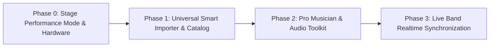

# 🗺️ Bandmate Canonical Roadmap (Unified 2026)

> **Vision**: Transform Bandmate into the ultimate high-performance stage and practice platform for musicians and bands, combining professional live tools, real-time band collaboration, seamless song management, and intelligent AI assistance.

---

## 📊 Roadmap Legend
- `[x]` **Completed**: Fully implemented, tested, and active in the codebase.
- `[~]` **In Progress**: Partially implemented, functional prototype, or currently undergoing refinement.
- `[ ]` **Not Started**: Planned for upcoming sprints.

---

## 📱 1. Core Architecture & Multiplatform Strategy

**Objective**: Shared modern codebase across Web, Android, and iOS with zero-latency audio and hardware integration.

- `[x]` **Modern Angular 21 Architecture**: 100% Standalone components, Signals (`signal`, `computed`, `input`), and new control flow (`@if`, `@for`, `@defer`).
- `[x]` **Backend & Data Storage**: High-performance Fastify API with Supabase (PostgreSQL, Row Level Security, Auth) and Redis.
- `[~]` **Capacitor Mobile Integration**: Capacitor installed and configured (`@capacitor/core`, `@capacitor/android`, `@capacitor/ios`), mobile safe-area styling in SCSS; native packaging and store distribution in progress.
- `[x]` **Audiovisual Clock Synchronization**: Zero-latency animation and audio sync binding GSAP 3 animations strictly to `Tone.Transport` and `Tone.Draw`.
- `[x]` **AI Engine Migration**: Unified Google GenAI SDK (`@google/genai`) with structured Zod outputs and dual-tier execution:
  - `gemini-2.5-flash`: Real-time streaming arrangement (`/ai/stream/arrangement`) and auto-categorization (`/ai/categorize`).
  - `gemini-2.5-pro`: Deep queued harmonic analysis and setlist rebalancing via rate-limited BullMQ.

---

## 💰 2. Monetization & Subscription Tiers (SaaS)

**Model**: Freemium with monthly and annual subscriptions powered by Stripe.

### 🥉 Free Tier (Musician)
- `[x]` Songs & Setlists CRUD with local and cloud persistence.
- `[x]` Inline Chord Editor & Viewer (`[Am]Hello [G]world`).
- `[x]` Transpose engine (chromatic circle +/- semitones with flat/sharp preservation).
- `[x]` Chord Audio Playback (tap to hear voicings via Tone.js PolySynth).
- `[x]` Basic Metronome & Tuner tools.
- `[x]` User Profile (instrument, bio, avatar).

### 🥈 Pro Tier (Pro Musician)
- `[x]` Unlimited Cloud Songs & Setlists.
- `[x]` Stripe Billing Integration (Customer Portal, Webhooks, Tier validation).
- `[x]` AI Ingestion & Smart Arrangement Assistant (Gemini streaming).
- `[~]` Advanced Practice Mode (Loops, tempo trainer, practice streaks).
- `[ ]` Bluetooth Pedal Support (Hands-free page turning & autoscroll toggles).
- `[ ]` Pro Strobe Tuner with custom instrument tunings (Drop D, DADGAD, Open G).

### 🥇 Band Tier (For Teams & Live Acts)
- `[x]` Band entity creation, custom roles (Owner, Admin, Member), and invite tokens.
- `[x]` Shared Repertoire: Band-scoped song library and shared setlists.
- `[x]` Event & Gig Management with QR Code Ticket check-in scanner.
- `[ ]` Stage Mode & Real-time Live Band Sync (Leader-Follower broadcast via Supabase Realtime).
- `[ ]` Stage Plot Maker & Automated Tech Rider Generator.

---

## 🗺️ Unified Historical Phases (Audit & Progress)

### Phase 1: MVP & Core Song Management
- `[x]` Full Songs CRUD (Create, Read, Update, Delete).
- `[x]` Structured lyrics & chord visualization (`chord-line-view`).
- `[x]` Inline bracket notation (`[Am]`) with dynamic character-offset layout.
- `[x]` Automatic persistence and reactive signal state stores.
- `[x]` Monospace font selection for stage readability.
- `[x]` Setlists creation, song assignment, and drag-and-drop reordering.

### Phase 2: Practice & Flow Enhancements
- `[x]` Auto-scroll engine with configurable speed, smooth acceleration, and pause/resume.
- `[x]` Visual metronome pulse synchronized with `Tone.Transport` and GSAP.
- `[~]` Keyboard shortcuts for hands-free control (Space to toggle, arrows to scroll).
- `[~]` Focus Mode (collapsible headers and toolbars for distraction-free rehearsal).
- `[x]` Guitar Chord Box Diagrams rendering fret positions and fingerings.

### Phase 3: Organization, Search & Metadata
- `[x]` Real-time multi-attribute search (title, artist, lyrics content).
- `[x]` Advanced filtering (by musical key, tempo/BPM, genre, rating).
- `[x]` Setlist execution order and total set duration calculator.
- `[~]` Spotify metadata enrichment (Spotify ID and album art integration).
- `[ ]` Reusable setlist templates (standard 45-min, 60-min, 90-min festival blocks).

### Phase 4: Authentication, Backend & Cloud Sync
- `[x]` Supabase Authentication (Email/Password, OAuth, Session Signals).
- `[x]` JWT HTTP Interceptor with auto-refresh and route guards (`AuthGuard`).
- `[x]` Centralized PostgreSQL schema with strict Row Level Security (RLS) policies.
- `[x]` Environment-based configuration (Development, Staging, Production on Render).
- `[x]` Multi-device cloud sync with offline IndexedDB fallback.

### Phase 5: Band Workspace & Social Collaboration
- `[x]` Band creation, roster management, and member role assignment.
- `[x]` Multi-tenant workspace switcher (Personal View vs. Band View).
- `[x]` Band-scoped songs and setlists with role-based editing permissions.
- `[~]` Musician discovery directory and band recruitment ("Looking for bassist" tags).
- `[ ]` Musician audition applications and private notes.

### Phase 6: Ecosystem, Audio & AI Utilities
- `[x]` Audio Tuner with Web Audio API autocorrelation frequency detection.
- `[x]` Tone.js Metronome with multiple time signatures (4/4, 3/4, 6/8).
- `[x]` Google GenAI (`gemini-2.5-flash`) structured outputs for song classification.
- `[x]` SSE Streaming AI arrangement generator for lyrics and chords.
- `[x]` Asynchronous BullMQ background worker for heavy AI musical jobs.

### Phase 7: Live Gigs & Events
- `[x]` Gig and Event scheduling with venue, date, call times, and attached setlist.
- `[x]` Digital ticket generator with unique QR verification codes.
- `[x]` Native camera QR scanner for fast door check-in.
- `[ ]` Interactive Stage Plot designer (drag-and-drop amps, drums, mics, monitors).
- `[ ]` PDF Tech Rider & Input List exporter for sound engineers.
- `[ ]` One-click band Electronic Press Kit (EPK) generator.

---

## 🚀 The Next Horizon: New Execution Roadmap (2026-2027)

*Designed specifically to elevate Bandmate from an everyday utility to an indispensable, professional stage tool.*

---

### 🎸 Phase 0: Stage Performance Mode & Hardware Interaction
**Goal**: Make Bandmate the most reliable, hands-free screen on stage under real gig conditions.

- `[x]` **High-Contrast Dark Stage Mode**:
  - `[x]` High-contrast OLED dark theme (#000000 background, vibrant chord highlights in amber/cyan).
  - `[x]` Scalable font controls with instant viewport resizing.
- `[x]` **Bluetooth Pedal & Foot-Switch Support**:
  - `[x]` Page Turner HID events listener (PageUp/PageDown, Arrow keys, space, Enter).
  - `[x]` Configurable pedal action mapping (Next Song, Previous Song, Scroll Down 50%, Toggle Autoscroll, Restart Song).
  - `[x]` Support for popular Bluetooth pedals (AirTurn, Donner, PageFlip, Coda Stomp) via `PedalListenerService` and HUD toast notifications.
- `[x]` **Dual-Column Responsive Stage Layout**:
  - `[x]` Multi-column masonry / CSS-column layout for tablets (iPad Pro, Galaxy Tab) in landscape mode.
  - `[x]` Eliminates scrolling entirely for songs under 80 lines with auto-balanced columns.
- `[x]` **Screen Wake Lock API**:
  - `[x]` Native `navigator.wakeLock` integration keeping screen illuminated indefinitely during Live/Practice modes without OS timeout.
- `[x]` **Real-time Tap Tempo**:
  - `[x]` Tap button with rolling average calculation over last 4 taps to set metronome BPM on the fly.
  - `[x]` Tone.Transport tempo synchronization.

---

### 📚 Phase 1: Universal Smart Importer & Music Catalog Scaling
**Goal**: Remove all friction in importing song libraries and scale the Bandmate song catalog legally and systematically.

- `[x]` **Universal Multi-Format Ingestion Engine**:
  - `[x]` Native ChordPro parser (`[Am]`, `{title}`, `{artist}`, `{key}`).
  - `[x]` **Legacy Text / UG Parser**: Auto-detection of 2-line plain text (chords placed on top of lyrics), calculating character indices and converting them into canonical inline `[Chord]` ChordPro tokens.
  - `[x]` **CifraClub Scraper/Importer**: Parser for HTML/DOM formatted song pages, translating `<b class="cnt">` tags into structured sections.
  - `[x]` **AI Smart Cleanup Fallback**: Using `gemini-2.5-flash` to clean messy copy-pasted chord sheets into structured sections (`[verse]`, `[chorus]`, `[bridge]`).
  - `[x]` **Universal Tab Import Dialog**: Modal with live ChordPro preview, sample presets, direct save to repertoire, and instant stage view launch.
- `[~]` **Two-Tier Catalog Data Model**:
  - `[x]` Schema separation between canonical `SongWork` (MusicBrainz ID, title, artist, rights status) and user/community `Arrangement` (chords, capo, key, timing).
  - `[~]` MusicBrainz Open Database integration for canonical discography and metadata lookup.
  - `[x]` **Default Song Catalog Expansion**: Rock/pop/blues staples seeded (Stand By Me, Let It Be, House of the Rising Sun, Creep, Wonderwall).
  - `[ ]` Community public song repository (musicians share and upvote verified chord arrangements).
- `[ ]` **Bulk Import & Export**:
  - `[ ]` OnSong, ChordPro (.pro, .cho, .chopro), PDF, and Plain Text batch import.
  - `[ ]` Setlist PDF export with custom stage font sizes and band watermark.

---

### 🌐 Phase Social: Musical Community & Social Feed (X / Instagram for Musicians)
**Goal**: Transform the community directory into a vibrant social network for musicians and bands.

- `[x]` **Social Feed Architecture & API**:
  - `[x]` Feed store, in-memory + persistent repo (`FeedRepo`), endpoints `GET /feed`, `POST /feed`, `POST /feed/:id/like`, `POST /feed/:id/repost`.
  - `[x]` Post types: `💬 Estado`, `🎸 Riff`, `🎵 Canción`, `🚨 Busco Músico` (Audition), `📅 Gig`.
  - `[x]` Attached interactive Bandmate song cards with direct `[▶ Tocar en Vivo]` navigation.
  - `[x]` Tier-1 UI/UX: Apple/X-inspired post composer, filter tabs ("Para ti" / "Siguiendo"), micro-interactions on Like/Repost.
- `[x]` **Musicians Directory & Band Invitations**:
  - `[x]` Instrument filter chips, geolocation discovery, direct band invite workflows.

---

### 🎛️ Phase 2: Pro Musician & Audio Toolkit
**Goal**: Replace standalone stage tuner and metronome hardware with studio-grade digital equivalents.

- `[x]` **Audio Instrument Tuner**:
  - `[x]` Real-time autocorrelation algorithm analyzing microphone input via Web Audio API.
  - `[x]` Cent-deviation calculation with visual flat/sharp needle gauge.
- `[ ]` **Pro Strobe Mode & Alternative Tunings**:
  - `[ ]` High-refresh 60 FPS strobe animation for high-precision guitar intonation setup.
  - `[ ]` Multi-instrument tuning presets: Guitar (Standard, Drop D, DADGAD, Open E, Half-Step Down), Bass (4-string, 5-string), Ukulele, Cello, Violin.
  - `[ ]` A4 calibration frequency slider (432 Hz to 446 Hz, default 440 Hz).
- `[x]` **Harmonic Audio Synthesizer**:
  - `[x]` Tone.js PolySynth voicing generator playing exact chord notes on user click.
- `[ ]` **Advanced Practice Loop Trainer**:
  - `[ ]` A-B section loop marker (loop difficult chorus/solo sections).
  - `[ ]` Speed Trainer: Increment tempo automatically by X BPM every N repetitions.

---

### 📡 Phase 3: Live Band Real-time Synchronization
**Goal**: Eliminate live stage misunderstandings by synchronizing all band members' devices in real time.

- `[ ]` **Supabase Realtime Stage Mesh**:
  - `[ ]` Ephemeral low-latency broadcast channels per band session (`band-live:{bandId}`).
  - `[ ]` Band Master / Follower protocol (Band leader or drummer device broadcasts state).
- `[ ]` **Synchronized Live Performance Controls**:
  - `[ ]` **Instant Song Switching**: When the leader selects song #4 in the setlist, all connected band members' screens immediately transition to song #4 with zero manual clicks.
  - `[ ]` **Synchronized Scrolling**: Leader's scroll position or section jumps (`[Chorus 2]`) replicate across follower devices.
  - `[ ]` **Visual Stage Cues**: Silent on-screen flash cues ("Solo in 4 bars", "Repeat Chorus", "Ending on 1") broadcasted across all tablets.
  - `[ ]` **Individual Transposition Autonomy**: Bassist or saxophonist can view the song in their own preferred key/instrument transposition (e.g. Bb/Eb horns) while staying synchronized to the master song position.

---

## 🏆 Definition of Done for Future Releases
Every feature added to Bandmate must satisfy:
1. **Zero-Latency Principle**: UI operations and audio timing never block the main thread.
2. **Stage Safety**: No accidental navigation during live playback; reliable offline operation.
3. **Responsive Signals**: All state handled reactively with Angular Signals and immutable patterns.
4. **Design & Accessibility Compliance**: Strict adherence to [DESIGN_SYSTEM_AND_ACCESSIBILITY.md](file:///docs/DESIGN_SYSTEM_AND_ACCESSIBILITY.md) incorporating **Vercel Web Design Guidelines**, **Accessibility Audit (WCAG 2.1 AA)**, **Frontend Design (Anthropic)**, and **UX/UI PRO MAX** standards.
5. **Automated Quality**: Verified via Vitest unit tests, Puppeteer visual regression checks, and clean production builds.
